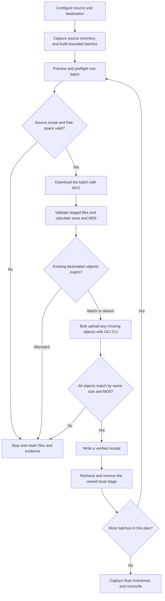

# Moving Oracle Managed Database Backups to OCI Alloy: A Reusable Batch Migration Pattern

How I combined MV2BUCKET, OCI CLI and a Python companion to move a large backup archive through a small staging area.

Moving several terabytes of database backups sounds like a storage problem. In practice, the harder questions are often much smaller: how do I access the managed source, point the upload at the right endpoint, recover after an interrupted session, and know when it is safe to clear local disk?

I encountered this during a migration to OCI Alloy. The source backups were in an Oracle-managed bucket. The destination used its own Object Storage endpoint. The database host had less than 90 GiB of free staging space and an older Linux environment.

The working solution was a Python companion around MV2BUCKET. I kept the MV2 executable unchanged, used it to list and download the source objects, and used OCI CLI for the destination upload. The companion controlled the batches, verification and local cleanup.

I have since separated that workflow into a configurable package for reuse. The planner and plan adapter in this package are new implementations; they are tested separately from the original migration scripts. The approach stays the same: move a bounded batch, verify it, preserve its evidence, then release its staging space.

## The scenario

There were three constraints to work around.

First, the source was a managed database backup archive, rather than a normal customer bucket that the destination credentials could list. MV2BUCKET provided the working source-access path through the database's existing OPC configuration.

Second, the Alloy destination needed an explicit endpoint and its own credentials. I wanted the upload to be independent of destination-region mappings in the installed MV2 version.

Third, the archive was much larger than local staging. Downloading everything first was not an option. Nor was deleting a downloaded batch immediately after an upload command returned: a successful copy needed evidence that the expected objects actually matched at the destination.

The host also influenced the design. A newer executable had reportedly encountered library compatibility errors. The working deployment used MV2BUCKET 3.0.0.2 and OCI CLI 3.4.4 with Python 3.6. I retained that working source-access combination instead of making a binary upgrade a prerequisite for the migration.

## The core idea: separate source access from destination upload

I divided the work between three components:

- **MV2BUCKET:** list and download objects from the managed source.
- **OCI CLI:** list and upload objects at the configured destination.
- **Python companion:** plan batches, check disk space, validate files, record receipts and clean verified local staging.

Oracle identifies MV2BUCKET as the Oracle Managed Bucket Content Manager and references My Oracle Support document 2723911.1. Obtain the executable and applicable usage guidance through Oracle's distribution channel; it is not included in the companion package. [Oracle MAA material](https://www.oracle.com/jp/a/tech/docs/cloud-maa-overview-ja.pdf), [MV2BUCKET support reference](https://support.oracle.com/epmos/faces/DocumentDisplay?id=2723911.1).

The important detail is that the companion does not replace MV2's source access. If MV2 cannot read a particular source, configuring a destination endpoint will not solve that problem.

## The migration flow



Any failed command or validation also stops the run. Unverified files remain available for investigation. The loop processes the selected plan; it does not keep polling for backups created later.

## Step 1: make both connections explicit

The source configuration contains the MV2 executable, database identity, database home, OPC file and OPC authentication wallet. These point to the existing source access configuration.

The destination is separate. This is the `target` section of an example job file:

```json
"target": {
  "oci_binary": "/usr/bin/oci",
  "endpoint": "https://objectstorage.alloy-region-1.example.invalid",
  "region": "alloy-region-1",
  "namespace": "destination_namespace",
  "bucket": "database-backup-migration",
  "config_file": "/secure/target/oci-config",
  "profile": "DESTINATION",
  "auth": "api_key",
  "cert_bundle": null
}
```

The `.invalid` address is a placeholder. Replace it with the actual HTTPS service origin, not a PAR URL or an object URL.

OCI CLI supports explicit endpoint, region, authentication and certificate-bundle settings. The companion supplies these on destination calls, so routing does not depend on a realm allowlist in the companion. [OCI CLI global options](https://docs.oracle.com/en-us/iaas/tools/oci-cli/latest/oci_cli_docs/oci.html).

An endpoint changes where the request goes. It does not grant access. The destination still needs valid credentials and the required IAM permissions. OCI tenancies belong to a realm, and realms are isolated; the source identity must not be assumed to work in the destination. [OCI configuration](https://docs.oracle.com/en-us/iaas/Content/API/Concepts/sdkconfig.htm), [Request signing](https://docs.oracle.com/en-us/iaas/Content/API/Concepts/signingrequests.htm), [OCI physical architecture](https://docs.oracle.com/en-us/iaas/Content/GSG/Concepts/concepts-physical.htm).

Version 1 supports `api_key` and `instance_principal`. Instance-principal authentication is usable only where that identity is valid and authorized for the destination. New-region authentication discovery can also require SDK region metadata; an explicit Object Storage endpoint does not configure every authentication service. Check the installed client and run a pilot. [Adding regions](https://docs.oracle.com/en-us/iaas/Content/API/Concepts/sdk_adding_new_region_endpoints.htm).

The job file contains paths, not embedded private keys. Keep the OPC wallet, destination configuration and any CA bundle outside staging and state. An OPC authentication wallet is also different from a TDE wallet backup that happens to be part of the data being copied.

## Step 2: give the job a disk budget

The example uses an exclusive batch ceiling of 25,000,000,000 bytes and a separate 5,000,000,000-byte reserve. These are decimal GB values and configurable limits.

The plan, stage and state directories are separate. Staging holds temporary backup files. State holds receipts and logs that must survive cleanup. Neither should contain credentials or another job's files.

MV2's table displays rounded sizes. The planner preserves those values and derives conservative upper bounds for planning. After download, the companion measures exact byte sizes.

A batch's source filters must cover exactly its planned names. If a filter scope is too large, the planner subdivides it. If it cannot represent the scope safely within the budget, it stops rather than dropping an object or broadening the download unexpectedly.

The companion also samples free space and staged bytes while transfers run. This is a watchdog, not a filesystem quota: space can change between checks. Use a dedicated disk-backed area and leave enough reserve for the host's other work.

## Step 3: capture the inventory and build a plan

The following commands run from the package directory. Assume the protected job file is `/secure/jobs/migration.json` and `/var/lib/mv2-evidence/job1` already exists with appropriate ownership. Create the parent of the configured plan directory as well.

```bash
python3 mv2_plan.py --config /secure/jobs/migration.json capture-source --out /var/lib/mv2-evidence/job1/source.txt
python3 mv2_plan.py --config /secure/jobs/migration.json capture-target --out /var/lib/mv2-evidence/job1/target.json
python3 mv2_plan.py --config /secure/jobs/migration.json build --source-inventory /var/lib/mv2-evidence/job1/source.txt
```

The captures retain native output, exit information, UTC timestamps and configuration provenance. The destination listing fetches every page, without a delimiter or a prefix that narrows the scope. OCI CLI's `--all` option is important here; a partial listing is not a full inventory. [Object-list reference](https://docs.oracle.com/en-us/iaas/tools/oci-cli/latest/oci_cli_docs/cmdref/os/object/list.html).

The planner creates a new plan and refuses to overwrite one. Each batch records its literal object names, selectors, size estimates and name-set digest. Before downloading a batch, a fresh MV2 listing must agree with that manifest.

For a normal migration I would plan the full source snapshot. The explicit catch-up option to exclude target-present names can reduce repeated downloads, but those exclusions prove name presence and size compatibility. They do not create source-content checksum evidence for the excluded objects.

## Step 4: transfer one representative batch first

```bash
python3 mv2_bulk.py --config /secure/jobs/migration.json preview 1
python3 mv2_bulk.py --config /secure/jobs/migration.json run 1
python3 mv2_bulk.py --config /secure/jobs/migration.json cleanup 1
```

Preview reads metadata and writes local diagnostics. It does not download, upload or delete backup objects. Review the source selection, destination context, estimated size and space requirement.

The run downloads through MV2 GET with native `--cksum` checking. It then requires the exact staged file set and computes each file's size and whole-file MD5. Existing destination objects must match those records. Missing names are uploaded, and fresh target metadata must match before a verified receipt is written.

OCI CLI bulk upload provides concurrency, no-overwrite, no-follow-symlinks and checksum-verification options. A skipped existing name is not treated as verification: the companion compares the object explicitly. [Bulk-upload reference](https://docs.oracle.com/en-us/iaas/tools/oci-cli/latest/oci_cli_docs/cmdref/os/object/bulk-upload.html).

This version uses `--no-multipart` so the destination MD5 is comparable with an ordinary whole-file MD5. A multipart checksum is derived from part hashes and needs a different verification strategy. OCI documents a 50 GiB maximum for a single PutObject; each object must also fit below the configured batch cap. [Object Storage limits](https://docs.oracle.com/en-us/iaas/Content/Object/Concepts/objectstorageoverview.htm), [Multipart checksum definition](https://docs.oracle.com/en-us/iaas/tools/dotnet/120.1.0/api/Oci.ObjectstorageService.Responses.GetObjectResponse.html).

The pilot retains staging by default. Cleanup rechecks the receipt, destination and owned local bytes before removing that batch directory. It never deletes source or destination objects.

## Step 5: run the remaining fixed plan

After reviewing the pilot, start at the appropriate next batch. For Bash:

```bash
nohup python3 -u mv2_bulk.py --config /secure/jobs/migration.json run-range --start 2 --cleanup-verified > /var/lib/mv2-evidence/job1/migration.log 2>&1 < /dev/null & disown
```

Omitting `--end` processes the rest of this plan. Each verified batch releases its stage before the next starts. The range stops at the first failure.

A verified receipt is bound to the job, manifest and relevant configuration fingerprints. On restart, its recorded names, sizes and hashes are checked against the destination before that batch is skipped. Changing the database, endpoint or plan must not reuse evidence from another job.

Partial downloads require more care. A file can exist without being complete. Local reuse requires a matching successful-download receipt and unchanged local records. Otherwise preserve the stage and logs, then create a separate retry job with new plan, stage and state directories and fresh captures. Changing only a stage path is insufficient because the plan is bound to the job configuration.

The configuration file also removes the need to restore export variables after reopening SSH. Background execution protects the process from an ordinary session disconnect; saved state protects the operator's understanding of what completed.

## Step 6: reconcile at the agreed cutoff

Finishing the range means the selected plan completed. Final reconciliation asks whether the intended source inventory is covered now.

```bash
python3 mv2_plan.py --config /secure/jobs/migration.json capture-source --out /var/lib/mv2-evidence/job1/source-final.txt
python3 mv2_plan.py --config /secure/jobs/migration.json capture-target --out /var/lib/mv2-evidence/job1/target-final.json
python3 mv2_plan.py --config /secure/jobs/migration.json reconcile --source-inventory /var/lib/mv2-evidence/job1/source-final.txt --target-inventory /var/lib/mv2-evidence/job1/target-final.json --out /var/lib/mv2-evidence/job1/reconciliation
```

The report compares literal names, source size bounds and destination sizes. It also shows destination-only objects rather than silently counting them as migrated source data.

Coordinate a cutoff if the source is changing. Another option is to capture the source before and after the target listing and compare both source inventories. Listings are not atomic, and unchanged names and rounded sizes do not prove unchanged mutable contents.

Compare against the original plan as well. New source names require a bounded catch-up plan. Original names no longer listed belong in a preserved exception ledger for investigation. Absence alone does not prove that they were copied or identify a deletion cause.

Keep three evidence layers distinct: inventory coverage, local-to-target checksum receipts and database restore validation. Aggregate totals are a useful volume check. They do not replace object-level reconciliation or establish database recoverability.

## What I packaged for reuse

The package separates configuration loading, inventory parsing, planning, manifest validation and transfer execution. The example job files contain synthetic paths and non-routable endpoint placeholders. There is no bundled MV2 executable, customer inventory or credential material.

That separation matters when adapting the workflow. A different source database should be a new job configuration and inventory, not a search-and-replace through the transfer code. A different Alloy operator should require destination settings and a pilot, not another hardcoded region branch.

From the package directory, the offline checks run with:

```bash
python3 -m unittest discover -s tests -v
```

These use temporary files and simulated tool responses. They exercise the companion's decisions without contacting a real bucket. They complement the live pilot; they do not prove that an external service accepts the configured credentials or exposes comparable checksums.

## Field lessons worth keeping

The operational details mattered as much as the transfer loop.

The older CLI needed a UTF-8 locale. The installed MV2 help command returned status 1, so the companion accepts that status only for the help probe, not operational failures. Captured output included ANSI formatting and progress-bar carriage returns; the parser recognizes the observed pre-table display while rejecting control characters inside object rows.

An empty destination response could contain only `{"prefixes": []}`. The parser handles that specific form but still rejects malformed inventories, duplicate names and incomplete source tables. These are compatibility lessons from the installed tools, not a diagnosis of a defect in MV2's data handling.

The package retains Python 3.6-compatible syntax for legacy hosts. Python 3.6 is end of life, so use a supported runtime for a new deployment. Offline tests and syntax compatibility checks do not certify every old runtime, authentication path or destination. [Python version status](https://devguide.python.org/versions/).

When a job stops, I would start with the reason rather than immediately retrying:

- **Source preflight differs:** capture the current inventory and investigate the change. Do not edit the manifest to hide it.
- **Destination object differs:** keep staging and compare the saved records. No-overwrite protects the existing object; it does not resolve the conflict.
- **Space or stage validation fails:** inspect other disk usage and any partial files. A new retry stage still needs room while the earlier evidence is retained.

The durable state is what makes this manageable. It explains which batch was selected, what the tools returned and whether download or destination verification completed. A terminal progress line alone cannot provide that history.

## A practical handover checklist

Before handing over a migration, I would retain:

- The protected job configuration, original plan and captured inventories.
- A successful representative pilot for the destination, authentication mode and CA configuration.
- Per-batch receipts and final reconciliation results, with checksum coverage stated explicitly.
- Any historical exceptions and a separately agreed restore/recovery test.

Local stage locks coordinate this companion, not every script or scheduler on the server. Destination access, source retention and other writers still need operational coordination. A conflicting target object, source drift, non-comparable checksum or unexpected staged file should stop the run for review.

## Closing thought

The useful change was separating two concerns that did not need to share one tool's destination mapping. MV2 continued to provide source access. OCI CLI handled the explicitly configured destination. Python made the operation bounded, restartable and reviewable.

That makes the pattern reusable for Alloy and other OCI-compatible destinations, subject to working source access and a successful live pilot. It is a way to configure and verify the transfer, not a bypass of realm isolation or a claim that every endpoint has been certified.

## References

- [MV2BUCKET — MOS document 2723911.1](https://support.oracle.com/epmos/faces/DocumentDisplay?id=2723911.1)
- [OCI CLI global options](https://docs.oracle.com/en-us/iaas/tools/oci-cli/latest/oci_cli_docs/oci.html)
- [OCI CLI bulk upload](https://docs.oracle.com/en-us/iaas/tools/oci-cli/latest/oci_cli_docs/cmdref/os/object/bulk-upload.html)
- [OCI CLI object listing](https://docs.oracle.com/en-us/iaas/tools/oci-cli/latest/oci_cli_docs/cmdref/os/object/list.html)
- [Adding region metadata](https://docs.oracle.com/en-us/iaas/Content/API/Concepts/sdk_adding_new_region_endpoints.htm)
- [Object Storage limits](https://docs.oracle.com/en-us/iaas/Content/Object/Concepts/objectstorageoverview.htm)
